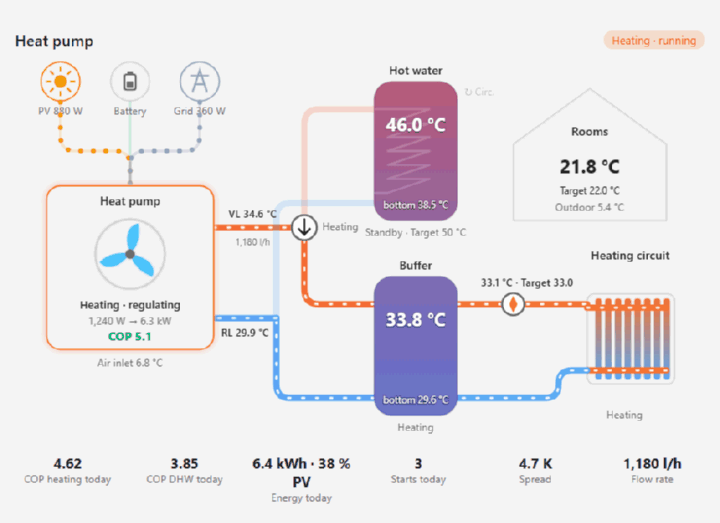
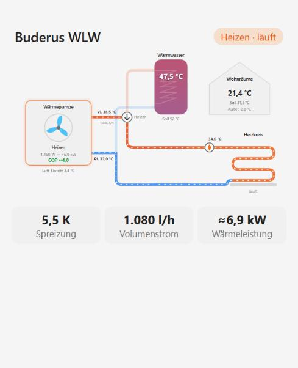
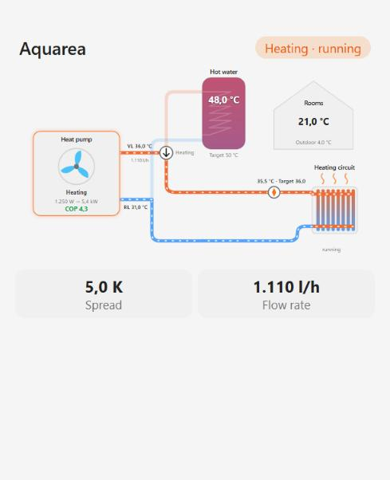

# Heatpump Flow Card

[](https://hacs.xyz/docs/faq/custom_repositories)
[](LICENSE)
[](https://github.com/Sturmi77/heatpump-flow-card/actions/workflows/validate.yml)
[](https://github.com/Sturmi77/heatpump-flow-card/releases)

[](https://my.home-assistant.io/redirect/hacs_repository/?owner=Sturmi77&repository=heatpump-flow-card&category=plugin)

An **animated hydraulic schematic** for air-to-water heat pumps in Home Assistant.

It shows electricity flowing from **PV, battery and grid** into the heat pump, the **diverter valve** switching between hot water and heating, colour-coded **tanks**, the **heating circuit** and your rooms. Animation speed follows the real flow rate. The core is vendor-neutral: **presets** make it zero-config for popular heat pumps:

| Preset | Brands / models | Integration | Status |
|---|---|---|---|
| `lambda` | **Lambda** (EU-L series) | [lambda_heat_pumps](https://github.com/GuidoJeuken-6512/lambda_heat_pumps) (HACS) | tested on a real installation |
| `vicare` | **Viessmann** (Vitocal) | [ViCare](https://www.home-assistant.io/integrations/vicare/) (core) | untested |
| `vaillant` | **Vaillant** (aroTHERM, aroTHERM plus), **Saunier Duval**, **Bulex**, **Glow-worm**, **DemirDöküm** | [myPyllant](https://github.com/signalkraft/mypyllant-component) (HACS) | untested |
| `emsesp` | **Bosch**, **Buderus**, **Junkers**, **Nefit**, **Worcester**, **Sieger**, **elm.leblanc**, **iVT** – EMS/EMS+ heat pumps such as Buderus Logatherm WLW, Bosch Compress, Nefit EnviLine | [EMS-ESP](https://github.com/emsesp/EMS-ESP32) gateway (MQTT discovery) | untested |
| `heishamon` | **Panasonic** Aquarea (H, J, K, L generation; monoblock, split, all-in-one) | [HeishaMon](https://github.com/heishamon/HeishaMon) + [heishamon-homeassistant](https://github.com/kamaradclimber/heishamon-homeassistant) (HACS) | untested |

> [!NOTE]
> The **Viessmann**, **Vaillant**, **EMS-ESP** and **HeishaMon** presets are **not yet tested with a real installation**. They are built from the source code of the respective integrations and checked with simulated data. Feedback is very welcome: please [open an issue](https://github.com/Sturmi77/heatpump-flow-card/issues) with your entity list if something is missing or wrong. The Lambda preset runs on a real installation.



**[Try the live demo](https://sturmi77.github.io/heatpump-flow-card/demo/)**: every preset in heating, hot water, defrost and standby, light and dark, English and German, with the matching card configuration. Runs in the browser with simulated data, no Home Assistant needed.

## Features

- **Power sources:** PV / battery / grid → heat pump, animated whenever more than 10 W flow. Taken automatically from your **Energy dashboard** (its power sensors), or from your own sensors.
- **Heat pump:** the fan spins while the compressor runs, faster at higher power. Shows mode and sub-state, electrical power → heat output, and live COP. Defrost is shown with a snowflake and an icy flow line.
- **Diverter valve:** shows DHW or heating; the active circuit is animated.
- **Tanks:** DHW tank and buffer with a top/bottom temperature gradient (blue = cold, red = hot), target, mode, a heat-exchanger coil while charging, and the circulation pump.
- **Heating circuit:** pump with either an **underfloor loop** or **radiators** with rising heat waves (`hc_type`), flow and target, plus a house with room temperature, target and outdoor temperature.
- **Flow rates:** shown on the heating-side loop, at the circuit pump (`hc_volume`) and at the source (`source_volume`). Units l/h, l/min and m³/h are converted automatically.
- **Estimated heat output:** without a heat output sensor, the card calculates it from flow rate × spread (≈ marker) and derives the COP from it.
- **Statistics row:** COP heating/DHW today, energy today with PV share, compressor starts, spread, flow rate, plus your own tiles.
- **Status chips:** mode, freely defined badges (e.g. "Boost"), error chip when any error code is ≠ 0.
- **Optional blocks:** whatever you don't have (buffer, DHW tank, power sources, house) is simply not drawn.
- **UI editor** with grouped entity pickers. **English and German**, following the HA language. Light/dark via your theme. Every element opens the more-info dialog. `prefers-reduced-motion` is respected.

| Viessmann preset, radiators | Vaillant preset, DHW run | Lambda zero-config, DHW run |
|---|---|---|
|  |  |  |

| EMS-ESP preset (Buderus) | HeishaMon preset (Panasonic), radiators | Other brand, minimal setup | Dark theme |
|---|---|---|---|
|  |  |  |  |

| Live on a real Lambda installation |
|---|
|  |

## Installation

### HACS (custom repository)
Click the **Open in HACS** button above, or:
1. HACS → ⋮ → **Custom repositories** → URL `https://github.com/Sturmi77/heatpump-flow-card`, type **Dashboard**.
2. Install **Heatpump Flow Card** and reload the browser.

### Manual
Copy `dist/heatpump-flow-card.js` to `/config/www/` and add `/local/heatpump-flow-card.js` as a JavaScript module under *Settings → Dashboards → Resources*.

## Quick start

### Lambda (lambda_heat_pumps)
```yaml
type: custom:heatpump-flow-card
preset: lambda
```
That's it. The card finds your entities itself (`sensor.<prefix>_hp1_…` with legacy naming, or `sensor.hp1_…` with the new naming). If you have several heat pumps or the detection picks the wrong one, set the prefix explicitly (`prefix: eu08l`) or the unit numbers (`index: {hp: 2, hc: 2}`).

PV, battery and grid come from your Energy dashboard automatically, as long as it has power sensors configured (Settings → Dashboards → Energy). If you already have sensors for the heat pump's share of PV, battery and grid, or want a room average, add them yourself; own `pv` / `battery` / `grid` sensors replace the Energy dashboard:
```yaml
type: custom:heatpump-flow-card
preset: lambda
title: Heat pump
entities:
  room: sensor.living_room_temperature
  pv: sensor.heatpump_power_from_pv          # W
  battery: sensor.heatpump_power_from_battery
  grid: sensor.heatpump_power_from_grid
  energy_today: sensor.heatpump_energy_today # kWh
badges:
  - entity: input_boolean.heatpump_boost
    label: Boost
```

### Viessmann Vitocal (ViCare) – untested, feedback welcome
```yaml
type: custom:heatpump-flow-card
preset: vicare
hc_type: radiator
```
Entities are found through the entity registry (platform `vicare` + translation key), so entity ids and the HA language don't matter. If you have several Viessmann devices, pick one with `device:` (device id, or use the editor).

What you get:
- flow and return of the secondary circuit
- source temperature and flow rate
- DHW tank top and bottom, buffer
- compressor phase, with DHW recognised via "DHW charging"
- compressor running and circulation pump
- COP heating and DHW, energy today, compressor starts

ViCare has no live electrical power, so add `power` from a meter if you have one; the heat output is estimated from flow rate × spread.

### Vaillant, Saunier Duval, Bulex, Glow-worm, DemirDöküm (myPyllant) – untested, feedback welcome
```yaml
type: custom:heatpump-flow-card
preset: vaillant
```
The home name prefix is detected from `sensor.<home>_energy_manager_state`.

What you get:
- the energy manager state (standby, heating, DHW, cooling) as the mode
- system flow temperature
- DHW tank and buffer
- circuit 0 flow, setpoint and state
- zone room temperature and target
- device power and heating efficiency
- trouble codes

The Vaillant cloud API has no return temperature and no compressor state, and values update every few minutes. Use `index: {hc: 1, dhw: 1}` for a second circuit or DHW system.

### Bosch, Buderus, Junkers, Nefit, Worcester, Sieger, elm.leblanc, iVT (EMS-ESP) – untested, feedback welcome
```yaml
type: custom:heatpump-flow-card
preset: emsesp
```
For heat pumps on the EMS bus via the [EMS-ESP](https://github.com/emsesp/EMS-ESP32) gateway with Home Assistant MQTT discovery. The entity ids come from the EMS-ESP short names (`boiler_hpactivity`, `boiler_hptc1`, …), so the EMS-ESP language does not matter for the ids. An instance prefix from the "multiple instances" entity format (e.g. `sensor.ems_esp_boiler_…`) is detected automatically. Compressor activity texts are understood in English and German.

What you get:
- compressor activity (heating, hot water, cooling, defrost) as the mode
- compressor running, 3-way valve, current compressor power
- heat carrier flow and return (TC1/TC0, falling back to the boiler flow and return)
- flow rate PC0
- air inlet (TL2) or brine inlet temperature
- outdoor temperature
- DHW temperature, target and circulation
- mixer circuit 1 flow and pump
- thermostat room temperature and target

Without a heat output sensor, the heat output is estimated from flow rate × spread. Use `index: {hc: 2}` for heating circuit 2.

### Panasonic Aquarea (HeishaMon) – untested, feedback welcome
```yaml
type: custom:heatpump-flow-card
preset: heishamon
```
For Panasonic Aquarea heat pumps with a [HeishaMon](https://github.com/heishamon/HeishaMon) board and the [heishamon-homeassistant](https://github.com/kamaradclimber/heishamon-homeassistant) integration. Entity ids follow the MQTT topics (`sensor.panasonic_heat_pump_main_main_outlet_temp`, …); a different MQTT prefix is detected automatically.

What you get:
- outlet and inlet temperature
- pump flow (L/min, converted)
- compressor frequency as "running"
- 3-way valve (Room/Tank)
- defrost
- heat power consumption and production, giving a live COP
- outdoor temperature
- DHW temperature and target
- zone 1 water and room temperature

HeishaMon has no "current activity" value: the card shows heating while the compressor runs, hot water when the valve is on "Tank", and defrost from the defrost state. If you use HeishaMon with your own MQTT YAML instead of the integration, map the entities manually (see below).

### Any other heat pump
Map your entities and translate your mode states to the card's normalized modes:
```yaml
type: custom:heatpump-flow-card
title: Heat pump
entities:
  mode: sensor.hp_operating_mode
  flow: sensor.hp_flow_temperature
  return: sensor.hp_return_temperature
  power: sensor.hp_power
  dhw_top: sensor.dhw_temperature
  outdoor: sensor.outdoor_temperature
  hc_pump: binary_sensor.heating_circuit_pump
mode_map:
  Heating: heating
  Hot water: dhw
  Defrost: defrost
  Standby: idle
```
Normalized modes: `heating`, `dhw`, `cooling`, `defrost`, `idle`, `blocked`, `frost`, `circulate`, `off` (plus `legionella`, `trailing` for the DHW tank). If your heat pump has a diverter-valve sensor, use `valve` (binary, on = DHW) instead of a DHW mode.

## Configuration

| Option | Description |
|---|---|
| `preset` | `lambda`, `vicare`, `vaillant`, `emsesp`, `heishamon` or omit. Fills entities, mode maps and error sensors. |
| `prefix` | Preset prefix (Lambda device name, Vaillant home slug, EMS-ESP instance prefix, HeishaMon MQTT prefix). Omit for auto-detection, `""` for unprefixed Lambda ids. |
| `device` | Device id: restricts preset detection to one device (several heat pumps of the same brand). |
| `index` | Unit numbers for presets: `{hp, dhw, buffer, hc}` (default 1; Vaillant counts from 0). |
| `hc_type` | `underfloor` (default) or `radiator`. |
| `title` | Card title (default: "Heat pump" / "Wärmepumpe"). |
| `language` | `auto` (default), `en`, `de`. |
| `power_threshold` | Counts as running above this electrical power in W (default 100). |
| `power_sources` | `auto` (default): PV / battery / grid from the Energy dashboard unless `pv`, `battery` or `grid` are set. `manual`: only your own sensors. |
| `entities` | Entity overrides (see below). `null` removes a preset entity. |
| `mode_map`, `dhw_mode_map`, `buffer_mode_map`, `hc_mode_map` | Raw state → normalized mode, merged over the preset. |
| `running_states` | Raw `status` values that count as compressor running. |
| `errors` | List of error-code sensors. A value ≠ 0 shows the error chip. |
| `badges` | `[{entity, label}]` chips shown while the entity is on. |
| `stats` | Extra tiles `[{entity, name, unit, decimals}]`. |

**Entity keys:**
- **Heat pump:** `mode`, `status`, `compressor` (binary, or frequency/speed > 0), `defrost` (binary), `power` (W or kW), `heat` (kW or W), `flow`, `return`, `volume`, `source_volume`, `source_in`, `outdoor`, `valve` (binary, or a state like `Tank`/`DHW`)
- **Storage:** `dhw_top`, `dhw_bottom`, `dhw_target`, `dhw_mode`, `circulation`, `buffer_top`, `buffer_bottom`, `buffer_mode`
- **Heating circuit and house:** `hc_flow`, `hc_return`, `hc_setpoint`, `hc_mode`, `hc_pump`, `hc_volume`, `room`, `room_target`
- **Power sources (W):** `pv`, `battery`, `grid` – the heat pump's power from each source. Optional: without them the card uses the Energy dashboard.
- **Statistics:** `cop_heating_today`, `cop_dhw_today`, `energy_today`, `pv_share_today`, `starts_today`

## Where the numbers come from
The card shows what your integration provides and does not invent values. Where it has to derive something, this is how:

| Value | Source |
|---|---|
| Temperatures, power, flow rate, daily COP, energy, starts | Read directly from the entities. Units are converted (W/kW, l/h, l/min, m³/h); nothing else is changed. |
| Spread | Flow minus return temperature. |
| Heat output | The heat output entity if there is one. Otherwise **estimated** as flow rate × spread × 1.163 Wh/(l·K) (water) and marked with **≈**. With glycol in the circuit the estimate is slightly too high. |
| Live COP | Heat output ÷ electrical power while the compressor runs. Marked with **≈** when the heat output is estimated. |
| Running | Compressor entity on (or frequency/speed > 0), electrical power above `power_threshold` (default 100 W), or a running status from the preset. |
| Mode | The operating-mode entity, translated by the preset's `mode_map`. Without a mode entity (e.g. HeishaMon): compressor off = standby, defrost entity on = defrost, valve on DHW = hot water, otherwise heating. |
| Diverter valve | The valve entity (on, `Tank` or `DHW` = hot water), otherwise the mode. |
| Heating circuit active | Circuit pump, else circuit mode, else "heat pump is heating". |
| PV / battery / grid flows | Your own `pv` / `battery` / `grid` sensors if set. Otherwise **estimated** from the Energy dashboard and marked with **≈**: the heat pump's power is split by the house's current supply mix (PV used in the house, battery discharge, grid import); PV first covers battery charging and export. Needs the power sensors of the Energy dashboard and the heat pump's `power`. A flow is animated above 10 W. |
| Error chip | Any error entity of the preset (or `errors`) with a value ≠ 0 or state on. |

Each preset section above lists the entities it uses.


## Topology
The layout is fixed on purpose: one heat pump, a diverter valve, an optional DHW tank, an optional buffer and one heating circuit (underfloor or radiators). That covers most single-family installations. Multiple heating circuits, combined/layered storage, heater rods and solar thermal are not drawn (yet).

## Adding a preset
Presets live in `HFC_PRESETS` in `dist/heatpump-flow-card.js`. A preset consists of:
- `detect(ctx)`, which returns a prefix, or `undefined` when the integration is missing
- `entities(prefix, index, ctx)`, which returns the entity map; values may be candidate lists, and the first existing entity wins
- optional `errors`
- the mode maps
- `running_states`, `status_labels` and `stat_labels`

`ctx.key(platform, domain, translation_key)` looks entities up in the entity registry, independent of language and entity ids. `ctx.match(regex, platform)` matches entity ids by pattern.

Pull requests for other brands are very welcome.

## Feedback
- **Your heat pump works (or not) with a preset?** Please use the [preset feedback form](https://github.com/Sturmi77/heatpump-flow-card/issues/new?template=preset_feedback.yml) – "works" reports help as much as bug reports.
- **Another brand?** Use the same form with "Request a new brand" and paste your entity list.
- **Something broken?** [Bug report](https://github.com/Sturmi77/heatpump-flow-card/issues/new?template=bug_report.yml).
- **Questions, ideas, showing off your setup?** Join the [Home Assistant Community thread](https://community.home-assistant.io/t/card-heatpump-flow-card-animated-hydraulic-schematic-for-heat-pumps-lambda-viessmann-vaillant-bosch-buderus-panasonic/1029598).

## Development
`demo/index.html` renders the card with simulated installations and scenarios (heating, DHW, defrost, standby with error, light/dark, English/German) without Home Assistant. It is published as the [live demo](https://sturmi77.github.io/heatpump-flow-card/demo/) via GitHub Pages; locally, open it through any static web server.

## Deutsch (Kurzfassung)
Animiertes Hydraulikschema für Luft-Wasser-Wärmepumpen: Strom aus PV, Akku und Netz (automatisch aus dem Energie-Dashboard oder aus eigenen Sensoren) → Wärmepumpe → Umschaltventil → Warmwasser bzw. Puffer → Heizkreis. Voreinstellungen erkennen die Entitäten automatisch für: Lambda; Viessmann (ViCare); Vaillant, Saunier Duval, Bulex, Glow-worm, DemirDöküm (myPyllant); Bosch, Buderus, Junkers, Nefit, Worcester, Sieger, elm.leblanc, iVT (EMS-ESP); Panasonic Aquarea (HeishaMon). Nur Lambda ist bisher mit einer echten Anlage getestet, alle anderen Voreinstellungen noch nicht – Rückmeldungen gern als Issue. Andere Hersteller werden über `entities` und `mode_map` angebunden. Heizkreis wahlweise als Flächenheizung oder Heizkörper. Volumenströme werden angezeigt, die Wärmeleistung wird bei Bedarf daraus berechnet. Grafischer Editor und Oberfläche auf Deutsch und Englisch. Ausprobieren ohne Installation: [Live-Demo](https://sturmi77.github.io/heatpump-flow-card/demo/).

## License
MIT © 2026 Sturmi77
