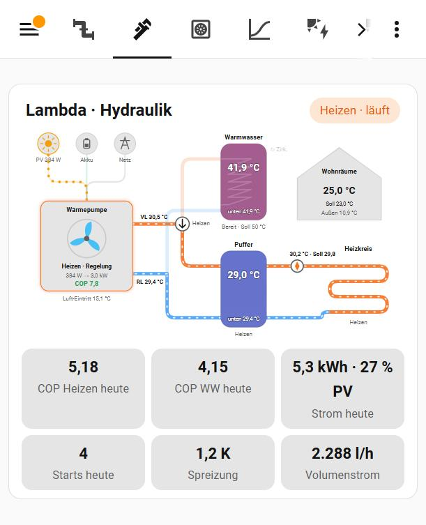
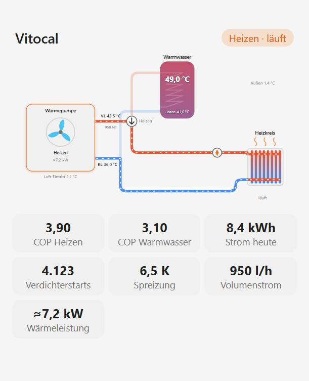
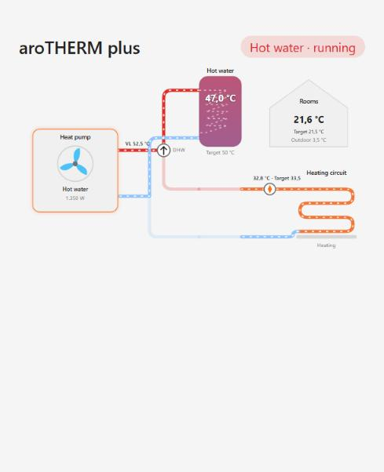
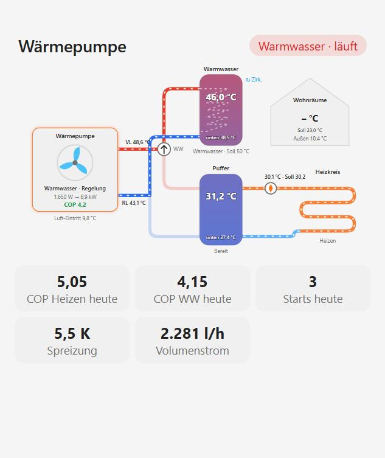
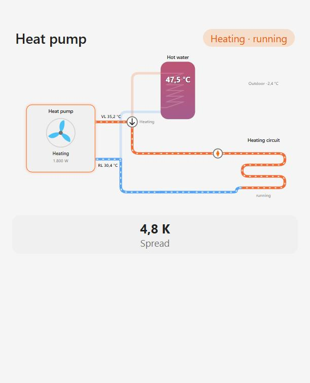
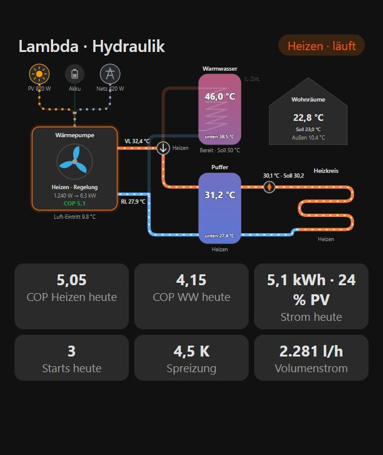
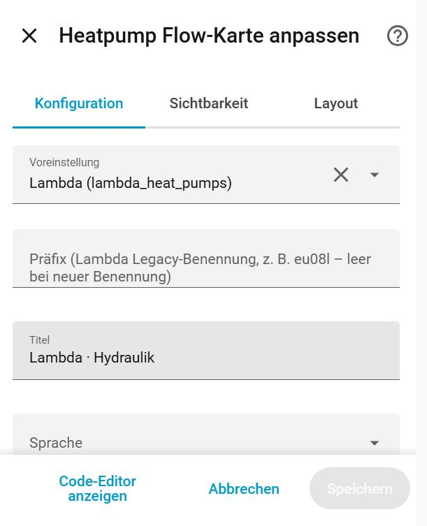

# Heatpump Flow Card

[](https://hacs.xyz/docs/faq/custom_repositories)
[](LICENSE)

An **animated hydraulic schematic** for air-to-water heat pumps in Home Assistant.

It shows electricity flowing from **PV, battery and grid** into the heat pump, the **diverter valve** switching between hot water and heating, colour-coded **tanks**, the **heating circuit** and your rooms. Animation speed follows the real flow rate. The core is vendor-neutral: **presets** make it zero-config for popular heat pumps:
- **Lambda** via [lambda_heat_pumps](https://github.com/GuidoJeuken-6512/lambda_heat_pumps)
- **Viessmann Vitocal** via the core [ViCare](https://www.home-assistant.io/integrations/vicare/) integration
- **Vaillant aroTHERM** via [myPyllant](https://github.com/signalkraft/mypyllant-component)



## Features

- **Power sources:** PV / battery / grid → heat pump, animated whenever more than 10 W flow.
- **Heat pump:** the fan spins while the compressor runs, faster at higher power. Shows mode and sub-state, electrical power → heat output, and live COP. Defrost is shown with a snowflake and an icy flow line.
- **Diverter valve:** shows DHW or heating; the active circuit is animated.
- **Tanks:** DHW tank and buffer with a top/bottom temperature gradient (blue = cold, red = hot), target, mode, a heat-exchanger coil while charging, and the circulation pump.
- **Heating circuit:** pump with either an **underfloor loop** or **radiators** with rising heat waves (`hc_type`), flow and target, plus a house with room temperature, target and outdoor temperature.
- **Flow rates:** shown on the heating-side loop, at the circuit pump (`hc_volume`) and at the source (`source_volume`). Units l/h, l/min and m³/h are converted automatically.
- **Estimated heat output:** without a heat output sensor, the card calculates it from flow rate × spread (≈ marker) and derives the COP from it.
- **Statistics row:** COP heating/DHW today, energy today with PV share, compressor starts, spread, flow rate, plus your own tiles.
- **Status chips:** mode, freely defined badges (e.g. "Boost"), error chip when any error code is ≠ 0.
- **Optional blocks:** whatever you don't have (buffer, DHW tank, power sources, house) is simply not drawn.
- **UI editor** with grouped entity pickers. **English and German**, following the HA language. Light/dark via your theme. Every element opens the more-info dialog. `prefers-reduced-motion` is respected.

| Viessmann preset, radiators | Vaillant preset, DHW run | Lambda zero-config, DHW run |
|---|---|---|
|  |  |  |

| Other brand, minimal setup | Dark theme |
|---|---|
|  |  |

## Installation

### HACS (custom repository)
1. HACS → ⋮ → **Custom repositories** → URL `https://github.com/Sturmi77/heatpump-flow-card`, type **Dashboard**.
2. Install **Heatpump Flow Card** and reload the browser.

### Manual
Copy `dist/heatpump-flow-card.js` to `/config/www/` and add `/local/heatpump-flow-card.js` as a JavaScript module under *Settings → Dashboards → Resources*.

## Quick start

### Lambda (lambda_heat_pumps)
```yaml
type: custom:heatpump-flow-card
preset: lambda
```
That's it. The card finds your entities itself (`sensor.<prefix>_hp1_…` with legacy naming, or `sensor.hp1_…` with the new naming). If you have several heat pumps or the detection picks the wrong one, set the prefix explicitly (`prefix: eu08l`) or the unit numbers (`index: {hp: 2, hc: 2}`).

The integration itself has no PV/battery/grid split or room average. Add your own sensors for those:
```yaml
type: custom:heatpump-flow-card
preset: lambda
title: Heat pump
entities:
  room: sensor.living_room_temperature
  pv: sensor.heatpump_power_from_pv          # W
  battery: sensor.heatpump_power_from_battery
  grid: sensor.heatpump_power_from_grid
  energy_today: sensor.heatpump_energy_today # kWh
badges:
  - entity: input_boolean.heatpump_boost
    label: 🚀 Boost
```

### Viessmann (ViCare)
```yaml
type: custom:heatpump-flow-card
preset: vicare
hc_type: radiator
```
Entities are found through the entity registry (platform `vicare` + translation key), so entity ids and the HA language don't matter. If you have several Viessmann devices, pick one with `device:` (device id, or use the editor).

What you get:
- flow and return of the secondary circuit
- source temperature and flow rate
- DHW tank top and bottom, buffer
- compressor phase, with DHW recognised via "DHW charging"
- compressor running and circulation pump
- COP heating and DHW, energy today, compressor starts

ViCare has no live electrical power, so add `power` from a meter if you have one; the heat output is estimated from flow rate × spread.

### Vaillant (myPyllant)
```yaml
type: custom:heatpump-flow-card
preset: vaillant
```
The home name prefix is detected from `sensor.<home>_energy_manager_state`.

What you get:
- the energy manager state (standby, heating, DHW, cooling) as the mode
- system flow temperature
- DHW tank and buffer
- circuit 0 flow, setpoint and state
- zone room temperature and target
- device power and heating efficiency
- trouble codes

The Vaillant cloud API has no return temperature and no compressor state, and values update every few minutes. Use `index: {hc: 1, dhw: 1}` for a second circuit or DHW system.

### Any other heat pump
Map your entities and translate your mode states to the card's normalized modes:
```yaml
type: custom:heatpump-flow-card
title: Heat pump
entities:
  mode: sensor.hp_operating_mode
  flow: sensor.hp_flow_temperature
  return: sensor.hp_return_temperature
  power: sensor.hp_power
  dhw_top: sensor.dhw_temperature
  outdoor: sensor.outdoor_temperature
  hc_pump: binary_sensor.heating_circuit_pump
mode_map:
  Heating: heating
  Hot water: dhw
  Defrost: defrost
  Standby: idle
```
Normalized modes: `heating`, `dhw`, `cooling`, `defrost`, `idle`, `blocked`, `frost`, `circulate`, `off` (plus `legionella`, `trailing` for the DHW tank). If your heat pump has a diverter-valve sensor, use `valve` (binary, on = DHW) instead of a DHW mode.

## Configuration

| Option | Description |
|---|---|
| `preset` | `lambda`, `vicare`, `vaillant` or omit. Fills entities, mode maps and error sensors. |
| `prefix` | Preset prefix (Lambda device name, Vaillant home slug). Omit for auto-detection, `""` for unprefixed Lambda ids. |
| `device` | Device id: restricts preset detection to one device (several heat pumps of the same brand). |
| `index` | Unit numbers for presets: `{hp, dhw, buffer, hc}` (default 1; Vaillant counts from 0). |
| `hc_type` | `underfloor` (default) or `radiator`. |
| `title` | Card title (default: "Heat pump" / "Wärmepumpe"). |
| `language` | `auto` (default), `en`, `de`. |
| `power_threshold` | Counts as running above this electrical power in W (default 100). |
| `entities` | Entity overrides (see below). `null` removes a preset entity. |
| `mode_map`, `dhw_mode_map`, `buffer_mode_map`, `hc_mode_map` | Raw state → normalized mode, merged over the preset. |
| `running_states` | Raw `status` values that count as compressor running. |
| `errors` | List of error-code sensors. A value ≠ 0 shows the error chip. |
| `badges` | `[{entity, label}]` chips shown while the entity is on. |
| `stats` | Extra tiles `[{entity, name, unit, decimals}]`. |

**Entity keys:**
- **Heat pump:** `mode`, `status`, `compressor`, `power` (W or kW), `heat` (kW or W), `flow`, `return`, `volume`, `source_volume`, `source_in`, `outdoor`, `valve`
- **Storage:** `dhw_top`, `dhw_bottom`, `dhw_target`, `dhw_mode`, `circulation`, `buffer_top`, `buffer_bottom`, `buffer_mode`
- **Heating circuit and house:** `hc_flow`, `hc_return`, `hc_setpoint`, `hc_mode`, `hc_pump`, `hc_volume`, `room`, `room_target`
- **Power sources (W):** `pv`, `battery`, `grid`
- **Statistics:** `cop_heating_today`, `cop_dhw_today`, `energy_today`, `pv_share_today`, `starts_today`



## Topology
The layout is fixed on purpose: one heat pump, a diverter valve, an optional DHW tank, an optional buffer and one heating circuit (underfloor or radiators). That covers most single-family installations. Multiple heating circuits, combined/layered storage, heater rods and solar thermal are not drawn (yet).

## Adding a preset
Presets live in `HFC_PRESETS` in `dist/heatpump-flow-card.js`. A preset consists of:
- `detect(ctx)`, which returns a prefix, or `undefined` when the integration is missing
- `entities(prefix, index, ctx)`, which returns the entity map; values may be candidate lists, and the first existing entity wins
- optional `errors`
- the mode maps
- `running_states`, `status_labels` and `stat_labels`

`ctx.key(platform, domain, translation_key)` looks entities up in the entity registry, independent of language and entity ids. `ctx.match(regex, platform)` matches entity ids by pattern.

Pull requests for other brands are very welcome.

## Development
`test/index.html` renders the card with simulated installations and scenarios (heating, DHW, defrost, standby with error, light/dark) without Home Assistant. Open it via a local web server.

## Deutsch (Kurzfassung)
Animiertes Hydraulikschema für Luft-Wasser-Wärmepumpen: Strom aus PV, Akku und Netz → Wärmepumpe → Umschaltventil → Warmwasser bzw. Puffer → Heizkreis. Voreinstellungen für Lambda, Viessmann (ViCare) und Vaillant (myPyllant) erkennen die Entitäten automatisch. Andere Hersteller werden über `entities` und `mode_map` angebunden. Heizkreis wahlweise als Flächenheizung oder Heizkörper. Volumenströme werden angezeigt, die Wärmeleistung wird bei Bedarf daraus berechnet. Grafischer Editor und Oberfläche auf Deutsch und Englisch.

## License
MIT © 2026 Sturmi77
